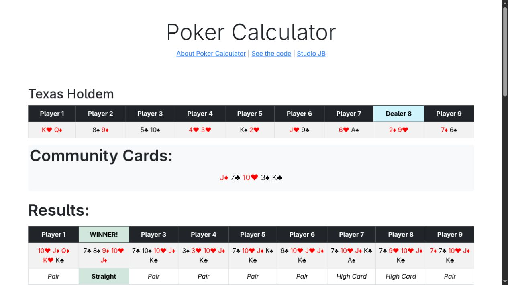

# Is poker.net a suitable starting point?

Research date: 2026-11-05. Inspected a shallow clone of `JBelthoff/poker.net`, pinned to [`c00f7f473f4236618ead28d923c0d775c7b44fdf`](https://github.com/JBelthoff/poker.net/tree/c00f7f473f4236618ead28d923c0d775c7b44fdf). The temporary checkout is `/tmp/poker-net-research`.

## Finding

**Yes, its C# ranking core is a plausible reusable component, and its demo is a useful interaction reference. It is not a ready-made offline Android odds calculator.** Reusing it requires a mobile interface, a variable-player adapter, and an odds/equity calculation loop. Choosing this core would make a C# Android app worth considering; liking the demo alone does not require changing the implementation stack.

## What the demo actually does

The root agent traversed the live demo on 2026-11-05: Deal produced nine random visible player hands and a dealer marker; Deal Flop, Deal Turn, and Deal River revealed the board in stages. River results showed each player’s best five cards, a hand category, winner markers, and a Shuffle button. No win, tie, or equity percentages were visible in that traversal. [Live demo](https://poker-calculator.johnbelthoff.com/)

The source agrees: `DoDeal` shuffles a deck, the flop and turn handlers restore and reveal it, and `DoRiver` evaluates the completed board. This is a hand-dealing walkthrough. A Monte Carlo odds calculation would instead repeatedly complete the same specified scenario and count outcomes. No such loop was found in the inspected app. [Page handlers](https://github.com/JBelthoff/poker.net/blob/c00f7f473f4236618ead28d923c0d775c7b44fdf/Pages/Index.cshtml.cs)

## Reuse boundaries verified in source

| Component | Evidence | Implication |
|---|---|---|
| License | Root `LICENSE` states MIT and requires retaining its notice. It also attributes the evaluator’s lineage to Cactus Kev. | Reuse is supported by the repository’s stated license; retain attribution with copied code. This was not a full provenance audit. |
| App project | Uses `Microsoft.NET.Sdk.Web`, targets `net10.0`, and references Dapper, Microsoft.Data.SqlClient, and Azure container tooling. | Do not reference the whole web project from the mobile app. Those dependencies do not belong in this offline calculator. |
| Numeric evaluator | `PokerLib.Eval5CardsFast(int, int, int, int, int)` returns a five-card score. `HandRank(int)` converts scores into categories. The file uses only standard .NET namespaces. | The core can be isolated without ASP.NET or SQL dependencies. Its inputs are encoded card values, not simple card IDs. |
| Completed-hand adapter | `EvaluateRiverNinePlayersArrays(Card[], bool)` and its index variant assume exactly nine players and fixed board positions. Each player’s best hand is selected from 21 five-card subsets. | Replace the fixed dealing layout with a small 2–6-player interface. Do not fabricate extra players just to satisfy the existing method. |

Sources: [License](https://github.com/JBelthoff/poker.net/blob/c00f7f473f4236618ead28d923c0d775c7b44fdf/LICENSE), [project file](https://github.com/JBelthoff/poker.net/blob/c00f7f473f4236618ead28d923c0d775c7b44fdf/poker.net.csproj), [PokerLib](https://github.com/JBelthoff/poker.net/blob/c00f7f473f4236618ead28d923c0d775c7b44fdf/Services/PokerLib.cs), [EvalEngine](https://github.com/JBelthoff/poker.net/blob/c00f7f473f4236618ead28d923c0d775c7b44fdf/Services/EvalEngine.cs), [encoded deck values](https://github.com/JBelthoff/poker.net/blob/c00f7f473f4236618ead28d923c0d775c7b44fdf/Models/RawDeck.cs).

Lower scores are stronger. The page finds the minimum score and marks every player with that same score as a winner, which permits ties. It does not accumulate tie probabilities or fractional pot shares. A new calculation loop must credit each of `k` tied winners with `1/k` of the pot for equity. Card uniqueness and valid encoded inputs must be checked before calling the numeric evaluator; its five-card entry point does not perform those checks. [Winner presentation](https://github.com/JBelthoff/poker.net/blob/c00f7f473f4236618ead28d923c0d775c7b44fdf/Pages/Index.cshtml), [PokerLib](https://github.com/JBelthoff/poker.net/blob/c00f7f473f4236618ead28d923c0d775c7b44fdf/Services/PokerLib.cs)

## Claims that should not drive our decision

The README advertises no lookup tables, but this pinned `PokerLib.cs` contains and uses `flushes`, `unique5`, `hash_adjust`, and `hash_values` arrays. The README also discusses benchmarks on a Windows desktop and directs benchmark reproduction to another branch and repository. We have not established that those results apply to this pinned source, Android’s runtime, or a full equity calculation. [README](https://github.com/JBelthoff/poker.net/blob/c00f7f473f4236618ead28d923c0d775c7b44fdf/README.md), [actual evaluator](https://github.com/JBelthoff/poker.net/blob/c00f7f473f4236618ead28d923c0d775c7b44fdf/Services/PokerLib.cs)

No automated test project was present in the inspected checkout. The page has manually selectable fixed decks for hand categories and a three-player tie, but those are not a substitute for automated correctness tests. External benchmark/test repositories were not audited. [Fixed-deck examples](https://github.com/JBelthoff/poker.net/blob/c00f7f473f4236618ead28d923c0d775c7b44fdf/Pages/Index.cshtml.cs)

## Smallest credible Android reuse path

If the user wants to reuse this C# code, put the numeric evaluator in a plain .NET library and consume it from a .NET for Android app. Microsoft provides Android SDK bindings and a supported Android workload for C#. MAUI can also consume C# logic, but its cross-platform UI layer is optional for an Android-only app. A normal Android-targeting project can use the base .NET API surface; the existing ASP.NET host should not be carried over. [Official .NET for Android](https://github.com/dotnet/android/blob/main/README.md), [installation requirements](https://learn.microsoft.com/en-us/dotnet/android/getting-started/installation/net-android), [target frameworks](https://learn.microsoft.com/en-us/dotnet/standard/frameworks), [MAUI architecture](https://learn.microsoft.com/en-us/dotnet/maui/what-is-maui?view=net-maui-10.0)

Then add only what the agreed calculator needs: legal card entry; 2–6-player hand ranking; completion of missing board cards; win/tie/equity accumulation; cancellable background calculation; and mobile results. Preserve the evaluator and attribution where possible rather than translating its internals into Kotlin. This is an architectural recommendation, not proof of an Android build.

Using the existing 21-subset approach for exact preflop odds would require about 72–91 million five-card evaluations over the supported player counts, derived from the [previous board counts](offline-engine-options.md). This is workload arithmetic, not a latency prediction. A native seven-card evaluator remains a comparison candidate if this C# path misses the eventual device target.

## Decisions and checks still open

- Resolved during this investigation: the user accepted manual hand review plus a random-deal practice flow. See [the scope decision](../issues/07-practice-scope.md). This does not select Monte Carlo estimation.
- Is preserving C# source valuable enough to choose .NET for Android, or is the demo only UI inspiration?
- Validate the extracted evaluator against an independent evaluator and known edge cases before trusting percentages.
- Measure exact preflop latency and cancellation on the target phone before selecting exact-only results or sampling.

No app was built, no evaluator was executed, and no mobile performance measurement was made. A successful offline Android package and correctness checks remain required before implementation claims can be made.

## Observed demo result

