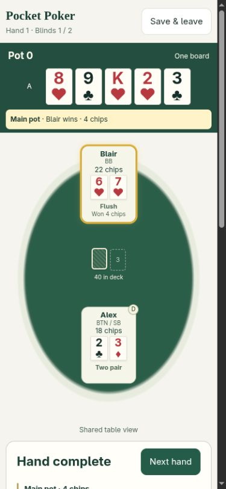

# Pocket Poker

A phone-focused Texas Hold’em prototype for **2–8 players on one shared device**, plus an open-card simulator for studying how hands are dealt. It uses play chips and runs entirely in the browser, with no account, backend, or runtime dependencies.

**Status:** working browser prototype. Android packaging and online multiplayer are not implemented. Equity mode and the refreshed Simulation are available on the local `codex/simulation-refresh` prototype branch; these changes have not been deployed.



## Features

### Pass & Play

- Enter player names in fixed clockwise seats. Each player starts with 20 chips; blinds stay at 1/2.
- Pass the device at each turn. Cards stay concealed until the player holds Peek or uses the optional tap-to-reveal setting.
- Check, call, fold, bet, raise, or go all-in. A whole-chip Min–Max slider sets the bet, and every action requires confirmation.
- Keep chips across hands, rotate the dealer and blinds, handle side pots and tied winners, and sit out players who run out of chips.
- Pause before each street so everyone is ready, then deal cards one by one.
- Use unanimous run-it-twice voting after betting is closed against all-in opponents. Both boards use the same deck and share any already-dealt community cards.
- See public hand categories during all-in runouts and results for each completed board. Public all-in hands finish automatically; ordinary private hands wait for Showdown. A fold win is immediate.
- Keep the pot and community cards visible while scrolling. Read betting history grouped by street, and celebrate winners with a popup, confetti, and seat glow.
- Save one game locally and resume with private cards concealed.

Optional hand guidance explains the current best five cards, kickers, and one-card straight or flush draws. It uses only the player's hole cards and the revealed board; it does not calculate equity or predict a winner.

### Simulation

Control every seat with visible hole cards, a compact clockwise table, sticky community cards, and the same confirmed slider bets as Pass & Play. Deal one street at a time, then inspect the hands before continuing. Each independent deal starts at 20 chips with 1/2 blinds.

Seats show Hand equity; player details show Win/Tie and best-five cards. Preflop uses 20,000 samples; postflop is exact. Folded cards and dealt burns remain unavailable, while future deck order is ignored. Two runouts show separate A/B percentages. Hand equity compares one hypothetical equal pot; actual chip payouts still follow main/side-pot rules.

Study Tools keeps per-card playback, speed, replay, deck/burn inspection, and guided examples. Every street pauses, including both runouts. Results and winner animations appear automatically when the hand finishes. Simulation stays in memory and does not change multiplayer saves.

See the [play guide](prototypes/README.md) for detailed behavior.

### Equity calculator

Choose **Play → Equity**. Enter two known cards for each of 2–8 players, then select Preflop, Flop, Turn, or River and fill that board stage. Each player row shows Equity, Win, and Tie, with the current hand category from the flop onward.

Preflop samples 20,000 boards and labels the results **Estimated**. Flop, turn, and river enumerate all remaining boards and display **Exact** results. Calculations run in a Web Worker, with progress and cancellation. Edits discard old percentages, and Calculate again restarts cancelled or failed work.

Card selection prevents duplicates. Removing entered cards through a stage/count change or Reset requires confirmation. Inputs survive mode changes during the visit but reset on page reload. Multiplayer saves are separate. This calculator assumes one equal pot and known hole cards; it does not support ranges, unknown hands, side pots, or two-board equity.

## Run locally

Install Python 3, then run from the repository root:

```sh
git clone https://github.com/gnaplds/pocket-poker.git
cd pocket-poker
python -m http.server 8765 --bind 127.0.0.1 --directory prototypes
```

Open [Pocket Poker locally](http://127.0.0.1:8765/dealing-prototype.html) on the same computer. No package installation or build step is needed.

You can also open `prototypes/dealing-prototype.html` directly, but browser support for saving games from local files varies. A phone's `127.0.0.1` address points to the phone itself, not your computer.

## Deploy on Netlify

1. In Netlify, add a project by importing an existing GitHub repository.
2. Select `gnaplds/pocket-poker` and the `main` branch.
3. Leave the base directory and build command empty. Set the publish directory to `prototypes` if it is not detected from `netlify.toml`.
4. Deploy, then open the assigned Netlify URL. The root path serves the game directly.

The included `netlify.toml` publishes the static prototype and rewrites `/` to `/dealing-prototype.html`. No environment variables, server, or package install are needed. The published folder also contains the prototype guide and tests; planning records outside it are available only through the GitHub repository. The existing live site is separate from unpublished local prototype changes.

See Netlify's [file-based configuration](https://docs.netlify.com/build/configure-builds/file-based-configuration/) and [rewrite documentation](https://docs.netlify.com/manage/routing/redirects/rewrites-proxies/) for these settings.

## How to play

1. Select **Play → Pass & Play**, choose 2–8 players, and enter names clockwise from the bottom seat.
2. Choose hold-to-peek or tap-to-reveal, and whether everyone gets hand guidance.
3. Start the game. Pass the phone to the named player, then tap **I'm ready**.
4. View your cards privately, choose an action, and confirm it. Pass the phone only after the cards hide.
5. When betting ends, wait until everyone is ready before dealing the next street.
6. Use **Showdown** when prompted. After reviewing the result, select **Next hand** beside the result title.

## Saves and privacy

One multiplayer game is stored in this browser's local storage. There is no cloud backup or cross-device sync. Clearing site data deletes the save. A new domain, browser, or device has a separate save; your localhost game will not automatically appear on Netlify.

The interface conceals other players' cards during private play, including on handoff and app interruption. This is a shared-device game among trusted players: inspecting browser storage or developer tools can reveal the game state. Use one active tab per game.

The app makes no outgoing network requests during play. A hosted page needs a connection to load; offline reload and installation as a PWA are not implemented.

## Tests

Use Node.js 26 or later. No npm dependencies are required.

```sh
node --test --test-isolation=none prototypes/dealing-prototype.test.cjs prototypes/dealing-prototype.ui.test.cjs prototypes/equity-prototype.test.cjs
```

The current suite has **83 tests** covering card order, hand rankings, betting rules, side pots, tied payouts, 2–8 players, two-board runouts, saved-game recovery, private views, and UI event handling. UI tests use a DOM boundary double; they do not replace browser or physical-device checks.

Desktop browser checks include phone-width layouts, concealed cards, runouts, result displays, and winner styling. Physical Android touch behavior and screen-reader testing remain pending. The evaluator is a JavaScript reference implementation and has not been exhaustively checked against every possible hand or betting sequence.

## Repository layout

| Path | Purpose |
| --- | --- |
| `prototypes/dealing-prototype.html` | Self-contained app: poker engine, session logic, and all three modes |
| `prototypes/dealing-prototype.test.cjs` | Engine and session tests |
| `prototypes/dealing-prototype.ui.test.cjs` | UI event and privacy tests |
| `prototypes/README.md` | Detailed play guide and validation history |
| `GLOSSARY.md` | Poker and game terms |
| `.scratch/` | Planning records, rules research, and prototype screenshots |

Earlier planning documents describe earlier versions. This README and the current prototype describe the latest behavior.

## Planned work

- Physical Android testing and Android packaging.
- Further accessibility and small-screen checks.
- Hands-on validation of the new Equity prototype before publishing it.

## References

The initial calculator idea came from [PokerCoaching](https://pokercoaching.com/odds-calculator/) and the [poker.net demo](https://poker-calculator.johnbelthoff.com/). The current prototype uses its own JavaScript evaluator; it does not embed or depend on [poker.net](https://github.com/JBelthoff/poker.net).

Rules research and decisions are recorded in the [multiplayer plan](.scratch/pass-and-play/spec.md), [decision map](.scratch/pass-and-play/map.md), and [rules notes](.scratch/pass-and-play/research/continuing-game-rules.md).

## License

Project code and original documentation are available under the [MIT License](LICENSE).

The retained reference screenshot `.scratch/mobile-calculator/research/pokernet-demo-river.png` depicts the third-party poker.net demo. It is research material, is not covered by this project's MIT grant, and retains its original rights. External projects, names, and linked materials remain the property of their respective owners.
