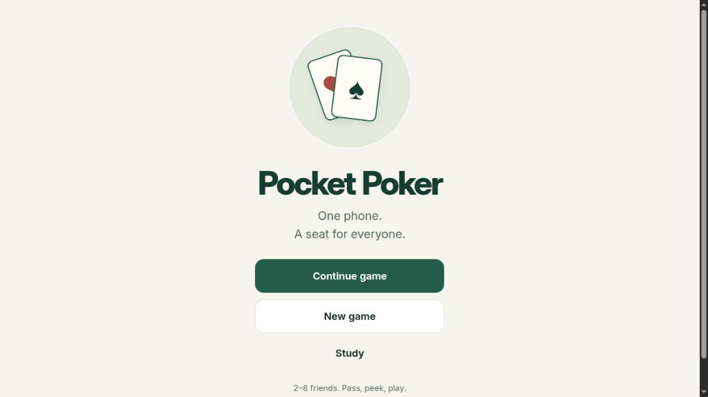

# Pocket Poker

Texas Hold’em for **2–10 friends sharing one phone**, with open-card Simulation and an Equity calculator for study. Play with small chip stacks, pass the phone for private turns, and keep playing across hands. No accounts, backend, or online multiplayer.

[Play Pocket Poker](https://pocket-poker.netlify.app/) · [Play guide](docs/play-guide.md) · [Development and deployment](docs/development.md)



## Play and study

Pass & Play, Simulation, and the Equity calculator each support 2–10 players.

- **Pass & Play:** 20 chips per player, fixed 1/2 blinds, private Peek, betting confirmations, side pots, rotating positions, saved games, and unanimous run-it-twice voting. Results offer Next hand or a same-group Rematch.
- **Simulation:** visible hole cards, independent 20-chip deals, manual betting for every seat, street pauses, replay of the same deck, and optional per-card Study Tools.
- **Equity calculator:** enter two known cards for each player and one community board. Preflop uses 20,000 sampled boards; postflop enumerates every possible remaining board.

**Hand rankings** lists hands from royal flush to high card. Five-card examples stay visible in a compact list; tap each entry to expand its explanation and tie rules.

Simulation and public all-in multiplayer seats show equity bars, with separate A/B bars for two runouts. The calculator shows bars beside each hand. Percentages remain readable: red → amber → green shows absolute equity; zero has an empty gray bar. Estimates use ≈. Equity includes split-pot shares and does not predict actual side-pot payouts.

Shuffle preparation, card dealing, showdown reveals, winning-card emphasis, and ordered chip collection give feedback without controlling payouts. Dealing blocks scrolling and taps until the next pause. Reduced motion skips decorative travel and pulses; private Peek always reveals and conceals immediately.

## Run locally

Use Python 3 from the repository root:

```sh
python tools/serve.py
```

Open [localhost:8765](http://127.0.0.1:8765/). No package installation or build step is needed. Use the local server rather than opening `index.html` as a file: routes and workers need HTTP.

## Screens and URLs

| URL | Screen |
| --- | --- |
| `/` | Opening: play, continue, or study |
| `/new-game` | Player names and game settings |
| `/play` | Current local Pass & Play game |
| `/study` | Study-mode menu |
| `/simulation` | Open-card Simulation |
| `/equity` | Manual Equity calculator |
| `/hand-rankings` | Visible card examples with expandable explanations |

A URL opens a screen, not a shared game. Opening `/play` resumes a valid local save with private cards concealed; without one it opens setup. Study entries survive screen changes in the same visit but reset on reload. The former `/dealing-prototype.html` entry redirects to `/`.

## Settings

On Home, the settings gear sits beside **Study**. Use the gear to choose 10 or T notation, reduced motion, and dealing speed across modes. Peek and guidance changes apply to the current multiplayer game; elsewhere they set defaults for new games. Defaults are 10 notation, Follow device for motion, and 1× dealing speed. Speed options range from 0.5× to 4× and keep readiness pauses. Changes apply immediately and save on this device; a warning appears if saving fails.

Settings hides private cards and keeps Save & Leave inside the panel. Close, Escape, or in-app browser Back dismisses the panel first. Closing normally returns to the same turn with cards concealed.

## Saves and privacy

One multiplayer game is saved in this browser's local storage. Changing paths on the same domain preserves it; a different domain, browser, or device has a separate save. Clearing site data deletes it. Use one active tab per game.

Settings → Save & Leave and in-app browser Back confirm before leaving Pass & Play. Reloading or closing a tab relies on automatic saves; a custom leave dialog cannot be guaranteed outside the app. Private cards hide on handoff, focus loss, and resume. Already-public all-in cards stay public.

This is a shared-device game among trusted players. Browser storage and developer tools can reveal game state. Hosted assets need a connection to load; offline reload, a service worker, and PWA installation are not implemented. There are no third-party runtime requests.

## Code and checks

The website uses plain HTML, CSS, JavaScript, and a locally hosted Inter font. One entry page loads focused source files; no framework or bundler is required.

```sh
node --test --test-isolation=none tests/*.test.cjs
```

Use Node.js 26 or later. Tests cover poker rules, privacy, saves, workers, equity, motion boundaries, and navigation. Browser and real-phone checks remain separate; see [validation](docs/validation.md).

| Path | Purpose |
| --- | --- |
| `web/index.html` | App entry and static screen/dialog markup |
| `web/scripts/` | Poker rules, sessions, screens, routes, equity, and motion |
| `web/styles/app.css` | Shared styles, preserving cascade order |
| `web/fonts/` | Inter and its license |
| `tests/` | Automated tests; not published to Netlify |
| `tools/serve.py` | Local server with clean-route support |
| `docs/` | Current play, development, and validation guides |
| `GLOSSARY.md` | Poker and game terms |
| `.scratch/` | Historical plans, experiments, and research |

The Godot Android rewrite stays on `codex/godot-android`. This website cleanup does not merge or change it. Historical plans may describe superseded behavior; current guides describe this branch. Production changes only after an approved merge/push to `main` and a successful Netlify deployment.

## Deployment

Netlify publishes `web/` with no build command or environment variables. `netlify.toml` defines old-link redirection, missing-asset handling, and the app route fallback. Tests and guides remain in GitHub rather than the public site. See [deployment steps](docs/development.md#deploy-on-netlify).

## References and license

The calculator idea drew from [PokerCoaching](https://pokercoaching.com/odds-calculator/) and the [poker.net demo](https://poker-calculator.johnbelthoff.com/). Pocket Poker uses its own JavaScript evaluator; it does not embed [poker.net](https://github.com/JBelthoff/poker.net). Earlier [rules research](.scratch/pass-and-play/research/continuing-game-rules.md) remains in the repository.

Project code and original documentation use the [MIT License](LICENSE). Inter uses the [SIL Open Font License](web/fonts/Inter-LICENSE.txt). GT Maru is not bundled.

The research screenshot `.scratch/mobile-calculator/research/pokernet-demo-river.png` depicts third-party content and is not covered by this project's MIT grant. External projects, names, and materials retain their original rights.
